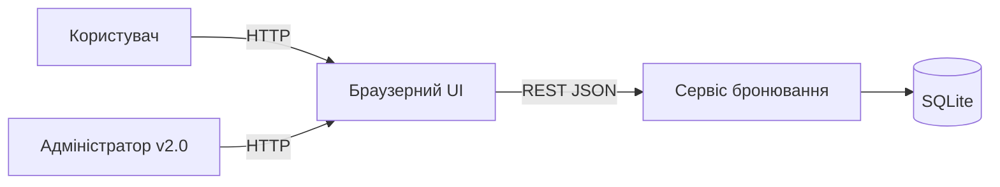
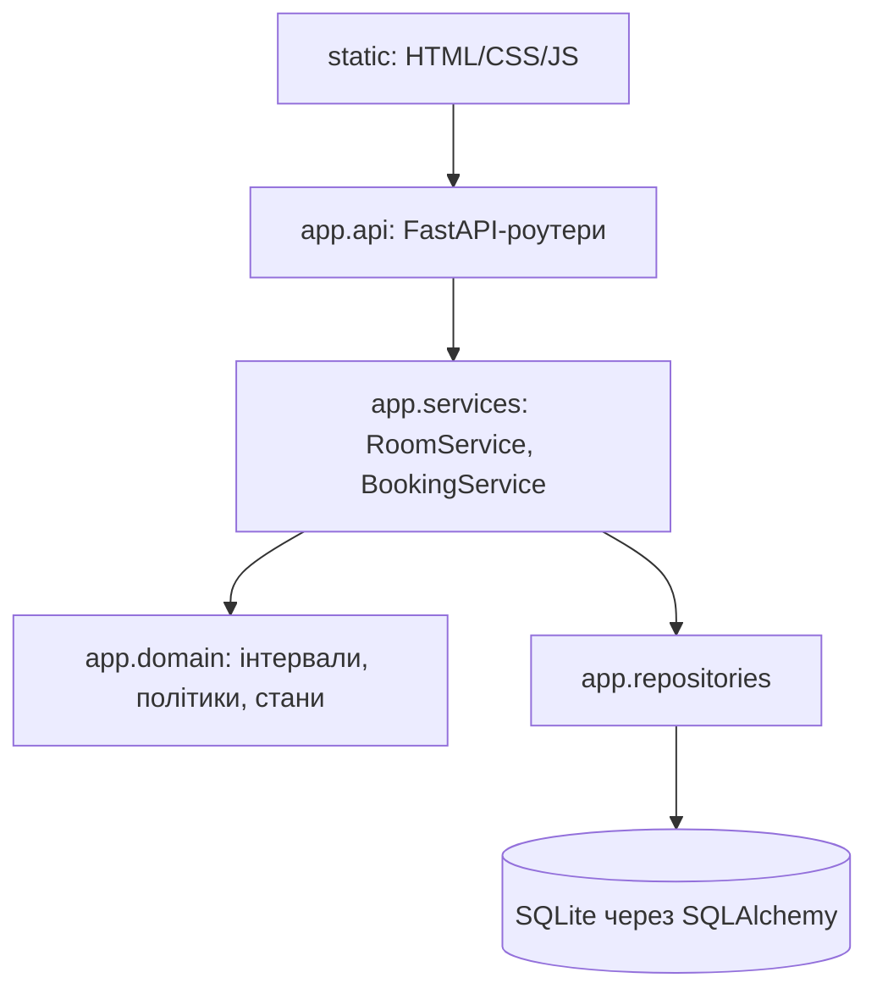
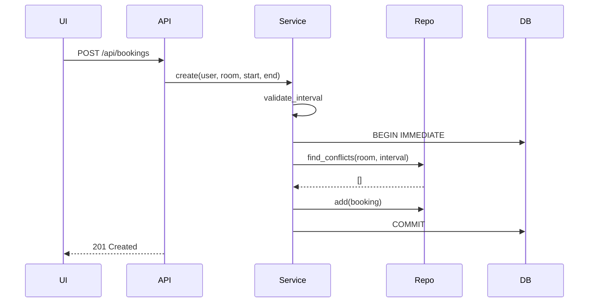

# Архітектура

Модульний моноліт: API → сервіси застосунку → доменна логіка → репозиторії → SQLite.

## Контекст

## Компоненти

## Створення бронювання

## Основні контракти API (v1.0)
| Метод | Шлях | Опис | Помилки |
|---|---|---|---|
| GET | /health | стан сервісу | — |
| GET | /api/rooms | список аудиторій | — |
| GET | /api/rooms/{id}/availability?start&end | перевірка доступності | 422, 404 |
| POST | /api/bookings | створити бронювання | 422, 409, 404 |
| GET | /api/bookings/my | бронювання поточного користувача | 401 |
| POST | /api/bookings/{id}/cancel | скасувати своє бронювання | 403, 404, 409 |

Користувач ідентифікується заголовком `X-User-Id` (навчальні акаунти).
