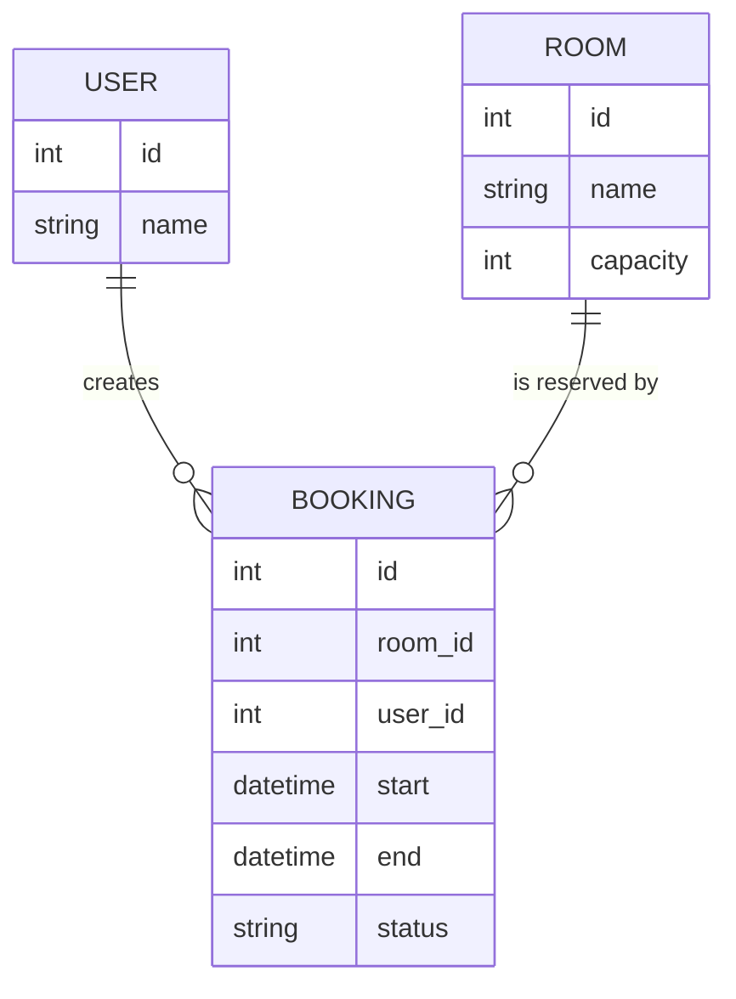
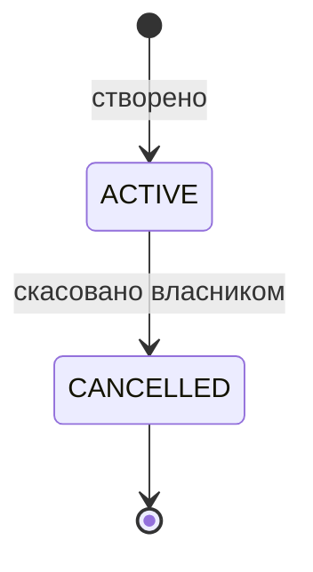

# Доменна модель

## Терміни
- **Аудиторія (Room)** — приміщення з назвою та місткістю.
- **Користувач (User)** — підготовлений навчальний акаунт.
- **Бронювання (Booking)** — резервування аудиторії користувачем на інтервал [start, end).
- **Інтервал** — піввідкритий проміжок часу в UTC.

## Сутності

## Стани бронювання v1.0

Скасоване бронювання звільняє слот. Повторне скасування — заборонений перехід.

## Конвенції валідації
- Усі дати приймаються у форматі ISO 8601 з часовим поясом; наївні значення відхиляються.
- Внутрішнє представлення — UTC.
- Помилка валідації: HTTP 422, код `INVALID_INTERVAL`; конфлікт: HTTP 409, `SLOT_CONFLICT`; доступ: HTTP 403, `FORBIDDEN`; технічна: HTTP 500, `INTERNAL_ERROR`.
